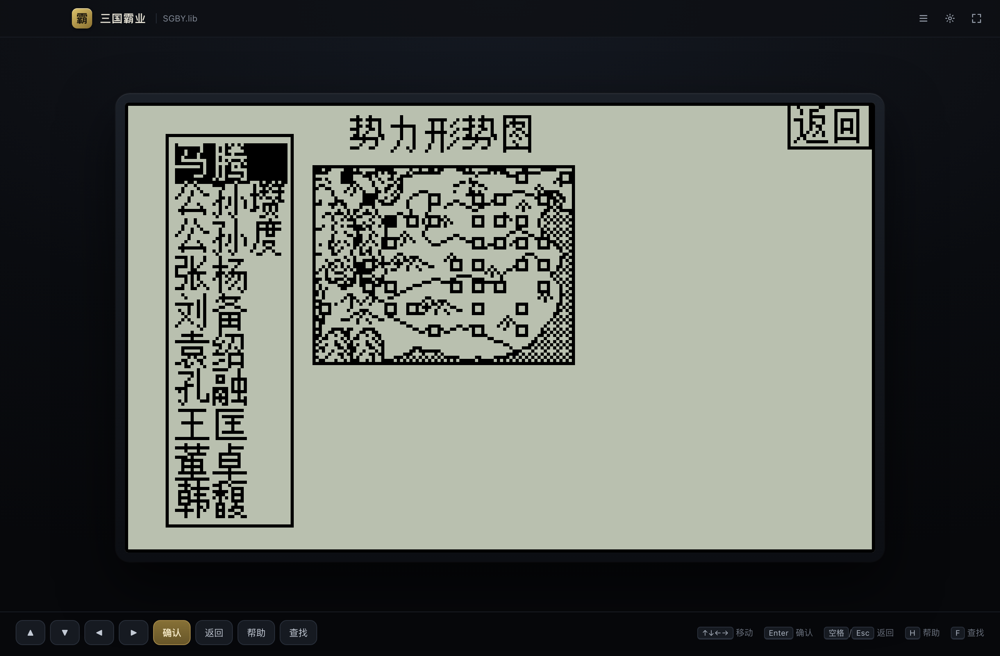

# 三国霸业

步步高电子词典经典游戏《三国霸业》的 H5 移植版，外加一个 macOS 桌面封装。

- 原项目：[kvinwang/baye-alpha](https://github.com/kvinwang/baye-alpha)
- 本仓库：`baye-alpha` 的完整静态资源 + 自建的 Electron 桌面外壳



## 两种运行方式

| 方式 | 入口 | 说明 |
|---|---|---|
| 桌面版（推荐） | `npm start` | Electron 应用，离线运行、文件存档、原生全屏 |
| 浏览器版 | 静态服务器 + `desktop.html` | 同一套外壳，存档退回 localStorage |

> 原项目的 `pc.html` 并不在本仓库里（上游部署时单独提供），桌面版用 `desktop.html`
> 重新实现了外壳，见下方目录说明。

## 桌面版快速开始

```bash
npm install
# 首次需要一次性下载 Electron 运行时
ELECTRON_CACHE="$PWD/.electron-cache" node node_modules/electron/install.js

npm start        # 启动
npm run pack     # 打包 .app（ad-hoc 签名，产物在 dist/）
npm run dist     # 打包 .app + .dmg + .zip
```

首次运行如果只打印一行版本号就退出，说明环境里有 `ELECTRON_RUN_AS_NODE=1`，
用 `env -u ELECTRON_RUN_AS_NODE npm start` 启动即可。

详细说明（存档位置、快捷键、签名公证、已知限制）见
[docs/desktop-macos.md](docs/desktop-macos.md)。

## 目录说明

```
desktop.html         桌面版入口（新写）
shell/               桌面外壳：样式、启动逻辑、存档桥
electron/            Electron 主进程与 preload
tools/               图标生成、macOS 打包脚本
js/                  引擎（baye.wasm + 胶水 + 脚本桥）
libs/                各版本游戏数据包（.lib）
docs/                规划与文档
index.html 等        原项目遗留的存档导出/版本选择页面
```

## 开发自检

```bash
npm run smoke                               # 引擎启动 + 协议 + 存档读写
BAYE_SMOKE_SHOT=/tmp/shot.png npm run smoke  # 同时截图
```

## 修改记录

一句话概括每个版本的主要改动。

- **0.1.0 · 2026-10-22** —— 新增 macOS 桌面版：用自建 Electron 外壳补上仓库缺失的 `pc.html`，以 `app://` 协议实现离线加载，存档改为真实文件并清理全部联网依赖，可直接打包运行。

## 授权提示

原游戏代码、引擎、美术素材、音乐的权利状态尚未确认。**在完成授权确认前，
不要公开发行或商业上架**（包括 Steam）。详见 [docs/plan_overview.md](docs/plan_overview.md) 的风险章节。
