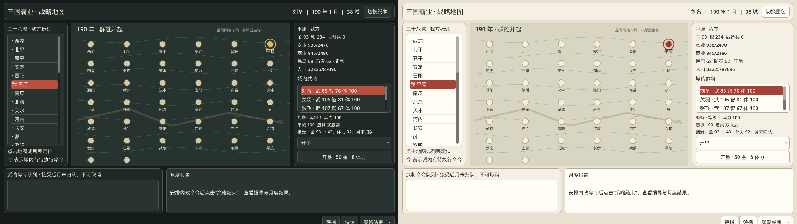

# 10 · 主界面与双风格样片

> 当前样片为 Main-M2A 的 190 年刘备、38 城真实界面。文件名为历史保留；旧 R0 的两城样片已被当前版本取代。尚无外部玩家试玩。

## 同屏对比

原始截图均为 1280×720：

- [深色墨色](assets/ui-dark.png)
- [浅色纸本](assets/ui-light.png)

可通过 `scripts/capture-ui.sh` 从同一 190 年刘备初始局面重新生成。

## 当前低保真流程

- 新开局可选择四个时期及对应真实君主，进入包含 38 城的战略地图。
- 地图与左侧列表联动；平原显示 main 的金粮、农业、商业、民忠、人口、防灾和后备兵。
- 右侧列出刘备、关羽、张飞、吴懿、丁奉及实际属性、体力、兵力和道具。
- 可选择开垦、招商、搜寻、治理、出巡，显示真实成本；接受后进入 `TimeCount=0` 队列，不提供取消退款。
- 策略结束执行玩家与其他势力的月度命令，显示报告并推进年月、归队。
- 支持存读档、墨色/纸本切换和鼠标完整操作。
- 所有展示来自 `MainGameView`；主题和选中状态不修改规则状态或 RNG。

main 未导出可靠城市坐标，当前地图使用明确标注的重写网格布局，不冒充 main 原图。

## 视觉规格

| 项目 | 深色墨色 | 浅色纸本 |
|---|---|---|
| 窗口底色 | `#151B1A` | `#E8E1D2` |
| 面板 | `#202825` | `#F5F0E5` |
| 地图 | `#26332E` | `#D8D6C2` |
| 正文 | `#EEE8D8` | `#302F2A` |
| 强调 | 朱红 `#B9503F` + 金色 `#E1B55A` | 朱红 `#A54235` |
| 默认正文 | 16 px | 16 px |
| 顶栏标题 | 21 px | 21 px |
| 城市文字 | 12–14 px | 12–14 px |

控件使用圆角 4–10 px、1 px 低对比边框和 8–12 px 间距。当前使用 Godot 默认字体与中文回退，跨平台一致性后续验证。

## 检查与限制

在 1280×720 真实窗口检查两套主题：38 城标签、五人属性、报告和底部操作均可见；存档、读档和策略结束未被裁切。重要状态同时使用文字、颜色和“令”标记。

- 44 项规则测试通过，编辑器及独立 macOS 应用 M2A 冒烟通过。
- 尚未验证高 DPI、复杂战报、完整战略菜单、战术战斗和外部玩家可理解性。
- 地形与节点为程序矢量绘制，无外部图片资产。
